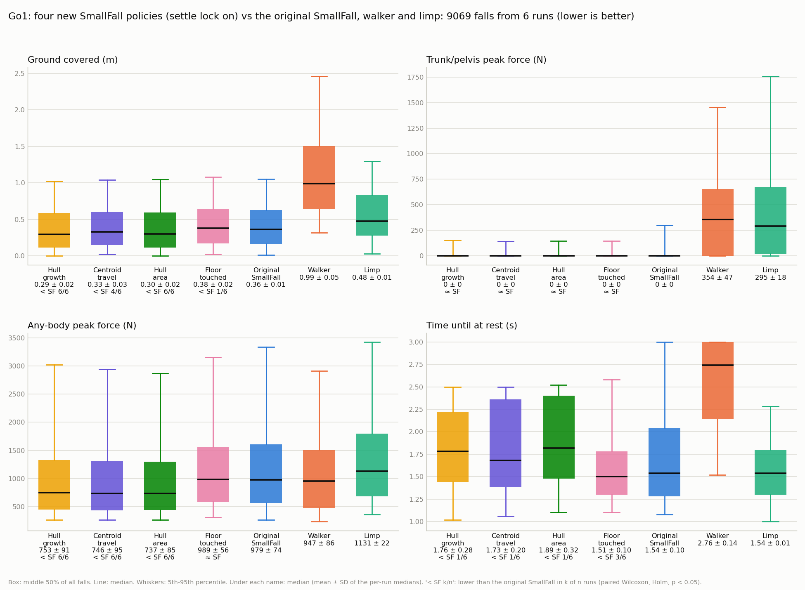

# SmallFall

Fall prediction and protective falling policies for two Unitree robots in
simulation: the **Go1 quadruped** and the **G1 humanoid**
([mjlab](https://github.com/mujocolab/mjlab) / MuJoCo Warp, RSL-RL PPO).

A walking policy is pushed (Go1 150 N, G1 200 N). A small MLP predicts a fall
about 0.3 s ahead; when it fires, control switches to **SmallFall**, a separate
PPO policy trained to keep the fall small: little ground covered, no trunk
impact, robot at rest.

```
walker ──(push)──▶ fall predictor ──(fires)──▶ SmallFall policy ──▶ robot at rest
```

## Results (six independent runs per robot, about 9,000 paired falls each)

Every flagged fall is replayed from the same start under seven policies: four
new SmallFall rewards, the original SmallFall, the walker continuing, and limp
(motors off). Median ground covered, mean ± SD across the six runs:

| Policy | Go1 (m) | G1 (m) |
|---|---|---|
| **SmallFall, hull growth** | **0.29 ± 0.02** | **0.55 ± 0.03** |
| SmallFall, hull area | 0.30 ± 0.02 | 0.57 ± 0.02 |
| SmallFall, centroid travel | 0.33 ± 0.03 | 0.62 ± 0.01 |
| SmallFall, original | 0.36 ± 0.01 | 0.66 ± 0.02 |
| SmallFall, floor touched | 0.38 ± 0.02 | 0.65 ± 0.03 |
| Limp | 0.48 ± 0.01 | 0.89 ± 0.02 |
| Walker | 0.99 ± 0.05 | 1.44 ± 0.07 |

- **Hull growth** (a reward on the growth of the floor area the fall sweeps)
  covers 19% (Go1) and 16% (G1) less ground than the original SmallFall,
  significant in 6/6 runs on both robots (paired Wilcoxon, Holm-adjusted).
- The new policies come to rest in 99-100% of falls (original 88-91%), take
  no trunk/pelvis impact, and lower the hardest impact on any body part.
- Fall predictor: AUPRC 0.85 (Go1) and 0.94 (G1) at a 2% base rate; it
  flagged every live fall, with a median warning of 0.33-0.35 s.
- The pre-registered test passed in 6/6 runs on both robots.



Full results, both robots: [`docs/SMALLFALL_RESULTS.md`](docs/SMALLFALL_RESULTS.md).
Earlier five-run Go1 study (original SmallFall only):
[`docs/GO1_MULTISEED_REPORT.md`](docs/GO1_MULTISEED_REPORT.md).

## Method in brief

- **Walkers:** mjlab's Go1 and G1 velocity tasks, 10,000 PPO iterations each.
- **Predictor:** MLP on the current observation and previous action; a step
  is labeled positive if a fall follows within 16 steps (0.32 s).
- **SmallFall:** PPO, 4,096 environments, episodes started from
  predictor-flagged fall states. Reward: contact-force and motion penalties
  adapted from arXiv:2512.01336, plus a fall-size term. The four new policies
  (hull growth, hull area, centroid travel, floor touched) train for 600
  iterations; at run time a **settle lock** holds the joints once the robot is
  low and still.
- **Evaluation:** separate fall banks for training, testing and evaluation in
  every run; paired tests within each run, then mean ± SD across runs.

Every design decision, with its reason and evidence, is logged in
[`DEVIATIONS.md`](DEVIATIONS.md).

## Running it

Training and evaluation need a CUDA GPU (developed on Colab A100/L4).
Open [`notebooks/go1_end_to_end.ipynb`](notebooks/go1_end_to_end.ipynb) or
[`notebooks/g1_end_to_end.ipynb`](notebooks/g1_end_to_end.ipynb) in Colab and
run it top to bottom: it clones this repository, trains everything, resumes
after a disconnect, and writes results to Google Drive. One run per seed takes
about 2-4 hours on an A100 once the walker exists.

Pinned versions: `mjlab==1.6.0`, `rsl-rl-lib==5.4.2`.

Unit tests run on CPU with mjlab stubbed:

```
pip install torch numpy scipy scikit-learn pillow pytest
python -m pytest -q tests
```

## Repository layout

| Path | Contents |
|---|---|
| `src/cartpole_term/protective/` | SmallFall task, rewards, fall-size measures, settle lock |
| `src/cartpole_term/go1/`, `g1/`, `common/` | Robot task configs, robot profiles, statistics, video helpers |
| `scripts/go1_*.py`, `scripts/robot_*.py` | One script per pipeline step (robot chosen with `--robot`) |
| `notebooks/` | Colab entry points ([index](notebooks/README.md)); built by `tools/notebook_builders/` |
| `docs/` | Results, figures, [full project notes](docs/PROJECT_NOTES.md) |
| `tests/` | CPU unit tests |
| `src/cartpole_term/` (top level), `scripts/` without a prefix | Earlier cartpole termination-predictor study ([spec](docs/CARTPOLE_SPEC.md)) |

Checkpoints, datasets and videos are not in the repository.

## Related work

- SafeFall, arXiv:2511.18509: predictor-triggered switch to a protective policy.
- arXiv:2512.01336: self-protective falling policy; source of the contact-force,
  base-velocity and action-rate reward weights.
- GYF, arXiv:2310.04828: fall protection on the Go1.

## License

MIT; see [`LICENSE`](LICENSE).
