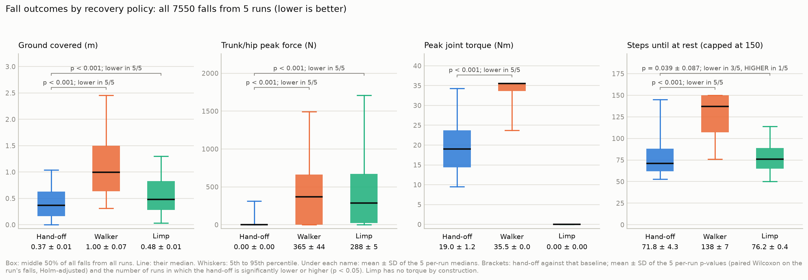

# SmallFall

Fall prediction and a protective falling policy for the Unitree Go1
quadruped, in simulation ([mjlab](https://github.com/mujocolab/mjlab) /
MuJoCo Warp, RSL-RL PPO).

A walking policy is pushed with 150 N. A small MLP predicts a fall up to
0.32 s ahead; when it fires, control switches to **SmallFall**, a separate
PPO policy trained to keep the fall small: little ground covered, no trunk
impact.

```
walker ──(150 N push)──▶ fall predictor ──(fires)──▶ SmallFall policy ──▶ robot at rest
```

## Results (five independent runs, 7,550 paired falls)

Every fall state is replayed from the same start under three policies:
SmallFall, the walker continuing, and limp (motors off).

| | SmallFall | Walker | Limp |
|---|---|---|---|
| Ground covered, median (m) | **0.37** | 1.00 | 0.48 |
| Trunk/hip peak force, median (N) | **0** | 365 | 288 |
| Peak joint torque, median (Nm) | 19.0 | 35.5 | 0 (motors off) |
| Steps until at rest, median | **72** | 138 | 76 |

- SmallFall covers less ground than the walker in 97% of falls and than
  limp in 78%, significant in 5/5 runs (paired Wilcoxon, Holm-adjusted).
- The hardest impact on any body part is not reduced relative to the walker.
- Fall predictor: AUPRC 0.85 ± 0.01 (logistic regression 0.73, chance 0.02);
  flagged every live fall, median warning 0.34 s.



Full report with all p-values and per-run results:
[`docs/GO1_MULTISEED_REPORT.md`](docs/GO1_MULTISEED_REPORT.md).

## Method in brief

- **Walker:** mjlab's Go1 velocity task, 10,000 PPO iterations.
- **Predictor:** MLP 60 → 128 → 128 → 1 on the current observation and
  previous action; labels a step positive if a fall follows within 16 steps.
- **SmallFall:** PPO (MLP 512-256-128), 4,096 environments, 201 iterations,
  episodes started from predictor-flagged fall states. Reward: contact-force
  and motion penalties adapted from arXiv:2512.01336, plus two original
  terms, the growth of the fall's ground envelope and of the peak impact.
- **Evaluation:** separate fall banks for training, selection and testing;
  paired tests within each run, then mean ± SD across runs.

Every design decision, with its reason and evidence, is logged in
[`DEVIATIONS.md`](DEVIATIONS.md).

## Running it

Training and evaluation need a CUDA GPU (developed on a Colab A100).

1. `python3 tools/build_code_zip.py` builds `cartpole_term_code.zip`.
2. Open [`notebooks/go1_end_to_end.ipynb`](notebooks/go1_end_to_end.ipynb)
   in Colab and run it top to bottom; it uploads the zip, trains everything
   and writes results to Google Drive. The walker takes several hours; the
   five evaluation runs about three hours together.

Pinned versions: `mjlab==1.6.0`, `rsl-rl-lib==5.4.2`.

Unit tests run on CPU with mjlab stubbed:

```
pip install torch numpy scipy scikit-learn pytest
python -m pytest -q tests
```

## Repository layout

| Path | Contents |
|---|---|
| `src/cartpole_term/go1/`, `protective/`, `common/` | Go1 task configs, SmallFall task and rewards, statistics |
| `scripts/go1_*.py` | One script per pipeline step |
| `notebooks/` | Colab entry points ([index](notebooks/README.md)) |
| `docs/` | Results report, figures, [full project notes](docs/PROJECT_NOTES.md) |
| `tests/` | CPU unit tests |
| `src/cartpole_term/` (top level), `scripts/` without `go1_` | Earlier cartpole termination-predictor study ([spec](docs/CARTPOLE_SPEC.md)) |
| `src/cartpole_term/g1/` | Scaffolding for a Unitree G1 humanoid port ([plan](docs/G1_PORT_PLAN.md)) |

Checkpoints, datasets and videos are not in the repository.

## Related work

- SafeFall, arXiv:2511.18509: predictor-triggered switch to a protective policy.
- arXiv:2512.01336: self-protective falling policy; source of the contact-force,
  base-velocity and action-rate reward weights.
- GYF, arXiv:2310.04828: fall protection on the Go1.
