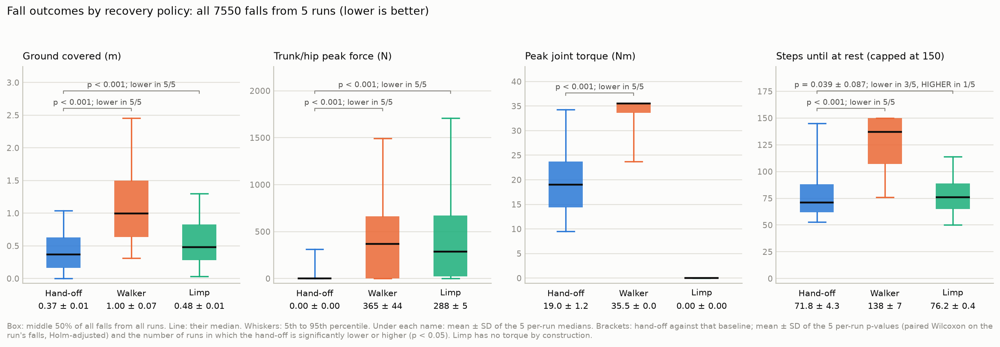
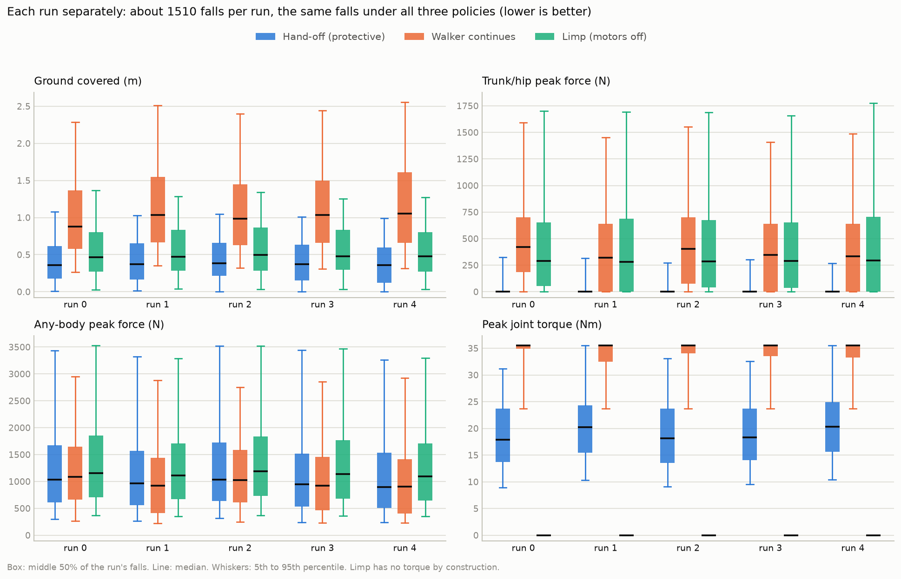
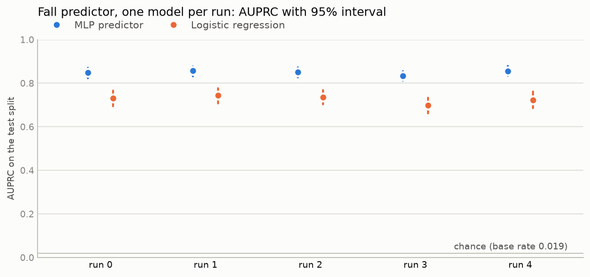

# Go1 fall pipeline: results of the five-run evaluation (`multiseed1`)

Run on NVIDIA A100-SXM4-40GB, mjlab 1.6.0, MuJoCo 3.11.0, torch 2.11.0+cu130. Generated from the run's saved result files by `tools/build_multiseed_report.py`.

## 1. Summary

One walking policy was trained once. Everything after it (the fall predictor, the fall-state banks, and the protective policy) was then built 5 independent times with different seeds, and each of the 5 runs was evaluated on about 1,510 falls it had never seen (7,550 falls in all). Every fall was replayed from the identical starting state under three policies: the **hand-off** to the protective policy, the **walker** carrying on, and **limp** (motors off).

- **The protective policy makes the fall smaller, in every run.** Median ground covered: hand-off 0.368 ± 0.012 m, limp 0.479 ± 0.013 m, walker 0.998 ± 0.070 m (mean ± SD of the 5 runs). The difference is significant in 5 of 5 runs against limp and 5 of 5 against the walker.
- **It keeps the trunk off the ground, in every run.** Median trunk/hip peak force is 0 N under the hand-off in all 5 runs, against 288 ± 5 N for limp and 365 ± 44 N for the walker.
- **It uses about half the walker's peak torque:** 19.0 ± 1.2 Nm against 35.5 ± 0.0 Nm.
- **The predictor is consistent across runs:** test AUPRC 0.850 ± 0.009 (chance is about 0.019), and live it flagged every real fall before it happened in all 5 runs, with a median warning of 17.0 ± 1.6 steps (0.34 s).

*Every box is drawn from all falls of all runs for that policy. Under each name: mean ± SD of the per-run medians. Brackets: the hand-off against that baseline, mean ± SD of the per-run p-values and the number of runs in which the hand-off is significantly lower or higher.*

## 2. What was run

| Stage | Per run | Details |
|---|---|---|
| Walker | shared | mjlab Go1 flat-velocity task, 10,000 PPO iterations, trained once (`model_9999.pt`) |
| Push | same setting | 150 N per axis on the trunk, 0.1-0.3 s, every 1-3 s |
| Predictor | one per run | MLP 60-128-128-1, predicts a fall within 16 steps (0.32 s); about 1M labelled steps per run; threshold chosen on validation |
| Training bank | one per run | about 500 robot states captured at the moment that run's predictor fires, each followed by a real fall |
| Protective policy | one per run | PPO from those states, round-8 reward, checkpoint at iteration 200 |
| Evaluation falls | three fresh banks per run | 1510, 1507, 1509, 1515, 1509 flag-moment states, never used in training |
| Comparison | per fall | each state replayed under hand-off, walker, and limp until at rest or 3 s |

**Measures (lower is better for all).** *Ground covered*: how far the farthest part of the robot gets from where the fall started, beyond its own reach at the start. *Trunk/hip peak force* and *any-body peak force*: the hardest ground contact on the trunk or hips, or on any body part. *Peak joint torque*: the largest torque at any joint. *Steps until at rest*: control steps (50 per second) until the robot has been still for 0.5 s, capped at 150.

**Tests.** Within each run, on that run's falls: a paired Wilcoxon signed-rank test for every measure and every pair of policies, the exact McNemar test for coming to rest, and the Friedman test across the three policies, with the pairwise p-values Holm-adjusted within the run (16 tests). After all 5 runs finished, each statistic was averaged across the runs (mean ± SD). No test pools falls across runs.

## 3. Recovery policies

### 3.1 Per-policy results (mean ± SD of the per-run values)

| Measure | Hand-off (protective) | Walker continues | Limp (motors off) |
|---|---|---|---|
| Ground covered (m), median | 0.368 ± 0.012 | 0.998 ± 0.070 | 0.479 ± 0.013 |
| Ground covered (m), 90th percentile | 0.880 ± 0.038 | 2.08 ± 0.08 | 1.13 ± 0.02 |
| Trunk/hip peak force (N), median | 0 ± 0 | 365 ± 44 | 288 ± 5 |
| Trunk/hip peak force (N), 90th percentile | 55.7 ± 47.5 | 1074 ± 50 | 1280 ± 41 |
| Any-body peak force (N), median | 974 ± 59 | 971 ± 79 | 1141 ± 37 |
| Any-body peak force (N), 90th percentile | 2674 ± 90 | 2323 ± 121 | 2757 ± 114 |
| Peak joint torque (Nm), median | 19.0 ± 1.2 | 35.5 ± 0.0 | 0 ± 0 |
| Peak joint torque (Nm), 90th percentile | 29.9 ± 2.3 | 35.5 ± 0.0 | 0 ± 0 |
| Steps until at rest (capped at 150) (steps), median | 71.8 ± 4.3 | 138 ± 7 | 76.2 ± 0.4 |
| Steps until at rest (capped at 150) (steps), 90th percentile | 116 ± 18 | 150 ± 0 | 103 ± 2 |

### 3.2 Hand-off against each baseline (mean ± SD across the runs)

| Measure | Baseline | Median paired difference (hand-off minus baseline) | Falls with hand-off lower | Rank-biserial effect size | p (mean ± SD) | Runs significant |
|---|---|---|---|---|---|---|
| Ground covered (m) **primary** | limp | -0.126 ± 0.007 | 78.4% ± 2.0% | -0.69 ± 0.04 | 2.2e-105 ± 4.8e-105 | 5 of 5 lower |
| Ground covered (m) **primary** | walker | -0.520 ± 0.052 | 97.1% ± 0.4% | -0.99 ± 0.00 | 3.9e-242 ± 0 | 5 of 5 lower |
| Trunk/hip peak force (N) | limp | -262 ± 10 | 93.4% ± 0.7% | -0.89 ± 0.01 | 2.6e-145 ± 5.8e-145 | 5 of 5 lower |
| Trunk/hip peak force (N) | walker | -330 ± 44 | 94.7% ± 0.7% | -0.91 ± 0.03 | 3.4e-132 ± 7.4e-132 | 5 of 5 lower |
| Any-body peak force (N) | limp | -142 ± 26 | 57.2% ± 1.2% | -0.16 ± 0.03 | 1.7e-05 ± 3.4e-05 | 5 of 5 lower |
| Any-body peak force (N) | walker | 67.5 ± 31.2 | 45.6% ± 2.1% | +0.09 ± 0.05 | 0.151 ± 0.335 | 0 of 5 lower, 4 of 5 higher |
| Peak joint torque (Nm) | walker | -14.1 ± 1.3 | 98.3% ± 1.1% | -0.99 ± 0.01 | 8.2e-226 ± 0 | 5 of 5 lower |
| Steps until at rest (capped at 150) (steps) | limp | -3.00 ± 3.74 | 55.2% ± 5.9% | -0.06 ± 0.18 | 0.039 ± 0.087 | 3 of 5 lower, 1 of 5 higher |
| Steps until at rest (capped at 150) (steps) | walker | -53.0 ± 5.7 | 90.4% ± 4.0% | -0.91 ± 0.06 | 2.8e-161 ± 6.2e-161 | 5 of 5 lower |

Rank-biserial runs from -1 (hand-off lower in every fall) to +1 (higher in every fall). A mean of p-values summarises the runs; the individual values are in section 3.3.

### 3.3 p-values and effect sizes, run by run

Holm-adjusted within the run. Each cell: p-value, then the median paired difference.

**Hand-off vs limp**

| Measure | Run 0 | Run 1 | Run 2 | Run 3 | Run 4 |
|---|---|---|---|---|---|
| Ground covered (m) | 1.7e-116; -0.126 | 1.1e-104; -0.123 | 1.4e-106; -0.115 | 1.0e-127; -0.134 | 1.7e-136; -0.130 |
| Trunk/hip peak force (N) | 4.3e-151; -269 | 6.3e-151; -250 | 1.2e-157; -252 | 1.3e-144; -268 | 4.6e-153; -269 |
| Any-body peak force (N) | 1.6e-06; -126 | 5.2e-06; -130 | 7.7e-05; -116 | 6.5e-10; -181 | 8.2e-10; -154 |
| Peak joint torque (Nm) | not tested (limp torque is 0) |  |  |  |  |
| Steps until at rest (capped at 150) (steps) | 2.4e-05; -7.00 | 9.7e-08; -3.00 | 4.2e-09; -5.00 | 0.194; -3.00 | 9.9e-17; 3.00 |
| Came to rest (McNemar); rates A / B | 7.2e-33; 0.911 / 0.997 | 0.625; 0.999 / 0.998 | 0.007; 0.981 / 0.993 | 2.8e-11; 0.963 / 0.997 | 4.7e-32; 0.918 / 0.997 |

**Hand-off vs walker**

| Measure | Run 0 | Run 1 | Run 2 | Run 3 | Run 4 |
|---|---|---|---|---|---|
| Ground covered (m) | 1.7e-241; -0.447 | 3.0e-242; -0.543 | 1.2e-244; -0.491 | 1.5e-244; -0.534 | 5.0e-244; -0.584 |
| Trunk/hip peak force (N) | 2.8e-173; -388 | 4.3e-140; -289 | 5.6e-169; -365 | 9.8e-134; -305 | 1.7e-131; -300 |
| Any-body peak force (N) | 0.750; 15.5 | 4.3e-05; 97.8 | 6.0e-04; 68.8 | 0.002; 73.2 | 5.0e-04; 82.4 |
| Peak joint torque (Nm) | 1.5e-239; -15.2 | 1.2e-226; -12.5 | 5.7e-238; -14.8 | 2.5e-238; -14.9 | 4.0e-225; -12.8 |
| Steps until at rest (capped at 150) (steps) | 4.2e-192; -50.0 | 2.0e-233; -60.0 | 1.2e-218; -54.0 | 1.3e-207; -56.0 | 1.4e-160; -45.0 |
| Came to rest (McNemar); rates A / B | 1.1e-74; 0.911 / 0.630 | 2.1e-210; 0.999 / 0.534 | 5.6e-152; 0.981 / 0.589 | 6.4e-158; 0.963 / 0.543 | 7.4e-128; 0.918 / 0.520 |

**Walker vs limp**

| Measure | Run 0 | Run 1 | Run 2 | Run 3 | Run 4 |
|---|---|---|---|---|---|
| Ground covered (m) | 1.4e-209; 0.321 | 4.5e-217; 0.436 | 1.5e-219; 0.372 | 4.6e-220; 0.398 | 8.2e-223; 0.420 |
| Trunk/hip peak force (N) | 1.2e-04; 75.4 | 0.418; 0 | 0.007; 35.3 | 0.194; 0 | 0.053; 0 |
| Any-body peak force (N) | 1.6e-06; -126 | 4.5e-20; -243 | 5.7e-15; -200 | 5.1e-20; -245 | 4.0e-20; -241 |
| Peak joint torque (Nm) | not tested (limp torque is 0) |  |  |  |  |
| Steps until at rest (capped at 150) (steps) | 2.4e-215; 48.0 | 1.3e-225; 56.0 | 2.5e-221; 52.0 | 2.3e-225; 55.0 | 1.9e-221; 56.0 |
| Came to rest (McNemar); rates A / B | 3.1e-160; 0.630 / 0.997 | 7.6e-210; 0.534 / 0.998 | 2.3e-171; 0.589 / 0.993 | 3.0e-200; 0.543 / 0.997 | 7.1e-212; 0.520 / 0.997 |

**Friedman test across the three policies**

| Measure | Run 0 | Run 1 | Run 2 | Run 3 | Run 4 |
|---|---|---|---|---|---|
| Ground covered | < 1e-300 (χ² 1962) | < 1e-300 (χ² 1950) | < 1e-300 (χ² 2013) | < 1e-300 (χ² 2077) | < 1e-300 (χ² 2088) |
| Trunk/hip peak force | 4.7e-277 (χ² 1273) | 8.6e-238 (χ² 1092) | 6.3e-272 (χ² 1249) | 4.3e-244 (χ² 1121) | 3.0e-244 (χ² 1121) |
| Any-body peak force | 2.5e-07 (χ² 30) | 5.2e-23 (χ² 103) | 2.3e-13 (χ² 58) | 5.3e-25 (χ² 112) | 2.0e-23 (χ² 105) |
| Steps until at rest (capped at 150) | < 1e-300 (χ² 1441) | < 1e-300 (χ² 1702) | < 1e-300 (χ² 1635) | < 1e-300 (χ² 1519) | 3.5e-272 (χ² 1250) |

### 3.4 Distributions

All 7,550 evaluation falls together, per policy:

| Measure | Policy | Mean | 5th | 25th | Median | 75th | 90th | 95th | Falls at exactly 0 |
|---|---|---|---|---|---|---|---|---|---|
| Ground covered (m) | Hand-off | 0.426 | 0.003 | 0.166 | 0.367 | 0.630 | 0.884 | 1.04 | 4.5% |
| Ground covered (m) | Walker | 1.13 | 0.311 | 0.636 | 0.996 | 1.50 | 2.08 | 2.46 | 0.0% |
| Ground covered (m) | Limp | 0.564 | 0.032 | 0.282 | 0.479 | 0.828 | 1.13 | 1.30 | 2.4% |
| Trunk/hip peak force (N) | Hand-off | 68.5 | 0 | 0 | 0 | 0 | 64.7 | 313 | 89.6% |
| Trunk/hip peak force (N) | Walker | 494 | 0 | 0 | 367 | 662 | 1079 | 1494 | 29.0% |
| Trunk/hip peak force (N) | Limp | 504 | 0 | 23.3 | 288 | 673 | 1285 | 1710 | 24.7% |
| Any-body peak force (N) | Hand-off | 1263 | 268 | 565 | 975 | 1608 | 2684 | 3395 | 0.0% |
| Any-body peak force (N) | Walker | 1156 | 234 | 504 | 965 | 1520 | 2333 | 2900 | 0.0% |
| Any-body peak force (N) | Limp | 1390 | 360 | 689 | 1140 | 1765 | 2768 | 3444 | 0.0% |
| Peak joint torque (Nm) | Hand-off | 19.7 | 9.50 | 14.4 | 19.0 | 23.7 | 30.1 | 34.3 | 0.0% |
| Peak joint torque (Nm) | Walker | 33.5 | 23.7 | 33.6 | 35.5 | 35.5 | 35.5 | 35.5 | 0.0% |
| Peak joint torque (Nm) | Limp | 0 | 0 | 0 | 0 | 0 | 0 | 0 | 100.0% |
| Steps until at rest (capped at 150) (steps) | Hand-off | 79.1 | 53.0 | 62.0 | 71.0 | 88.0 | 117 | 145 | 0.0% |
| Steps until at rest (capped at 150) (steps) | Walker | 127 | 76.0 | 107 | 137 | 150 | 150 | 150 | 0.0% |
| Steps until at rest (capped at 150) (steps) | Limp | 78.3 | 50.0 | 65.0 | 76.0 | 89.0 | 103 | 114 | 0.0% |

Per-run medians:

| Measure | Policy | Run 0 | Run 1 | Run 2 | Run 3 | Run 4 | Mean ± SD |
|---|---|---|---|---|---|---|---|
| Ground covered (m) | Hand-off | 0.356 | 0.370 | 0.385 | 0.371 | 0.357 | 0.368 ± 0.012 |
| Ground covered (m) | Walker | 0.880 | 1.04 | 0.985 | 1.04 | 1.05 | 0.998 ± 0.070 |
| Ground covered (m) | Limp | 0.464 | 0.473 | 0.499 | 0.480 | 0.477 | 0.479 ± 0.013 |
| Trunk/hip peak force (N) | Hand-off | 0 | 0 | 0 | 0 | 0 | 0 ± 0 |
| Trunk/hip peak force (N) | Walker | 421 | 322 | 402 | 346 | 335 | 365 ± 44 |
| Trunk/hip peak force (N) | Limp | 289 | 281 | 285 | 292 | 293 | 288 ± 5 |
| Any-body peak force (N) | Hand-off | 1032 | 967 | 1031 | 945 | 895 | 974 ± 59 |
| Any-body peak force (N) | Walker | 1082 | 921 | 1025 | 918 | 907 | 971 ± 79 |
| Any-body peak force (N) | Limp | 1159 | 1115 | 1191 | 1142 | 1096 | 1141 ± 37 |
| Peak joint torque (Nm) | Hand-off | 17.9 | 20.3 | 18.2 | 18.3 | 20.3 | 19.0 ± 1.2 |
| Peak joint torque (Nm) | Walker | 35.5 | 35.5 | 35.5 | 35.5 | 35.5 | 35.5 ± 0.0 |
| Peak joint torque (Nm) | Limp | 0 | 0 | 0 | 0 | 0 | 0 ± 0 |
| Steps until at rest (capped at 150) (steps) | Hand-off | 68.0 | 71.0 | 69.0 | 72.0 | 79.0 | 71.8 ± 4.3 |
| Steps until at rest (capped at 150) (steps) | Walker | 128 | 142 | 133 | 143 | 145 | 138 ± 7 |
| Steps until at rest (capped at 150) (steps) | Limp | 77.0 | 76.0 | 76.0 | 76.0 | 76.0 | 76.2 ± 0.4 |

### 3.5 Each run's separate test bank

Besides the evaluation falls, each run was checked once on a further fresh bank of about 500 flag moments. Medians:

| Run | Ground: hand-off | walker | limp | Trunk force: hand-off | walker | limp | Any-body force: hand-off | walker | limp | Torque: hand-off | walker |
|---|---|---|---|---|---|---|---|---|---|---|---|
| 0 | 0.353 | 0.883 | 0.464 | 0 | 408 | 320 | 1087 | 1104 | 1223 | 17.6 | 35.5 |
| 1 | 0.323 | 1.03 | 0.428 | 0 | 321 | 271 | 878 | 852 | 1139 | 20.7 | 35.5 |
| 2 | 0.421 | 0.963 | 0.504 | 0 | 403 | 300 | 1055 | 1026 | 1149 | 18.7 | 35.5 |
| 3 | 0.348 | 0.988 | 0.453 | 0 | 328 | 294 | 875 | 870 | 1085 | 18.5 | 35.5 |
| 4 | 0.326 | 1.01 | 0.432 | 0 | 318 | 295 | 797 | 879 | 1088 | 20.7 | 35.5 |

## 4. Fall predictor

### 4.1 Test-split performance, run by run

Intervals are 95%, from resampling whole episodes (1,000 resamples). p-values are bootstrap p-values for a zero difference; 0.001 is the smallest the resampling can report.

| Run | Test steps / episodes | Base rate | MLP AUPRC [95% CI] | MLP AUROC [95% CI] | Logistic regression AUPRC | MLP minus logistic regression [95% CI] | p vs logistic regression | p vs chance | Brier |
|---|---|---|---|---|---|---|---|---|---|
| 0 | 148,478 / 768 | 0.0192 | 0.848 [0.823, 0.870] | 0.9926 [0.9906, 0.9944] | 0.732 | +0.117 [0.095, 0.139] | 0.001 | 0.001 | 0.0066 |
| 1 | 147,712 / 773 | 0.0214 | 0.857 [0.832, 0.877] | 0.9891 [0.9856, 0.9919] | 0.744 | +0.112 [0.086, 0.139] | 0.001 | 0.001 | 0.0070 |
| 2 | 149,021 / 761 | 0.0188 | 0.852 [0.827, 0.873] | 0.9905 [0.9873, 0.9931] | 0.735 | +0.117 [0.094, 0.139] | 0.001 | 0.001 | 0.0063 |
| 3 | 146,923 / 773 | 0.0204 | 0.835 [0.811, 0.855] | 0.9871 [0.9834, 0.9902] | 0.698 | +0.136 [0.114, 0.161] | 0.001 | 0.001 | 0.0072 |
| 4 | 152,070 / 770 | 0.0173 | 0.856 [0.833, 0.879] | 0.9920 [0.9892, 0.9944] | 0.722 | +0.134 [0.108, 0.158] | 0.001 | 0.001 | 0.0058 |
| **Mean ± SD** |  | 0.019 ± 0.002 | 0.850 ± 0.009 | 0.990 ± 0.002 | 0.726 ± 0.018 | 0.123 ± 0.011 |  |  | 0.0066 ± 0.0006 |

### 4.2 At the decision threshold, and per falling episode

| Run | Threshold (from validation) | Precision per step [95% CI] | Recall per step [95% CI] | F1 | Falling test episodes flagged before the fall | Median lead, steps [95% CI] (capped at 16) |
|---|---|---|---|---|---|---|
| 0 | 0.445 | 0.826 [0.782, 0.863] | 0.693 [0.664, 0.725] | 0.754 | 177 of 178 | 12 [12, 14] |
| 1 | 0.271 | 0.741 [0.701, 0.780] | 0.796 [0.770, 0.822] | 0.767 | 197 of 198 | 14 [13, 15] |
| 2 | 0.428 | 0.828 [0.793, 0.864] | 0.718 [0.687, 0.746] | 0.769 | 175 of 175 | 13 [12, 14] |
| 3 | 0.330 | 0.745 [0.705, 0.786] | 0.755 [0.725, 0.782] | 0.750 | 187 of 187 | 14 [13, 14] |
| 4 | 0.263 | 0.706 [0.667, 0.751] | 0.829 [0.805, 0.852] | 0.763 | 164 of 164 | 15 [14, 16] |

### 4.3 Live, on the walking robot

1,024 robots per run walking under the push with the predictor watching; a flag counts as right if the robot falls within 3 s.

| Run | Real falls | Falls not flagged first | Recall | Flags raised | Share of flags followed by a fall | Median warning |
|---|---|---|---|---|---|---|
| 0 | 798 | 0 | 1.000 | 890 | 0.897 | 15 (0.30 s) |
| 1 | 630 | 0 | 1.000 | 903 | 0.698 | 17 (0.34 s) |
| 2 | 741 | 0 | 1.000 | 881 | 0.841 | 16 (0.32 s) |
| 3 | 686 | 0 | 1.000 | 894 | 0.767 | 18 (0.36 s) |
| 4 | 692 | 0 | 1.000 | 943 | 0.734 | 19 (0.38 s) |
| **Mean ± SD** |  |  | 1.000 ± 0.000 |  | 0.787 ± 0.081 | 17.0 ± 1.6 steps |

## 5. Secondary observations

- **Coming to rest.** The hand-off came to rest within 3 s in 91.1%, 99.9%, 98.1%, 96.3%, 91.8% of falls (runs 0-4); limp in 99.6% and the walker in 56.3% on average. In the 344 hand-off falls (4.6%) that did not meet the stillness thresholds, the robot stays where it is: median trunk force is 0 N and median ground covered is 0.323 m, against 0.368 m for the falls that did. On inspection of the videos this is small residual foot movement, and the 99% settle criterion written before the run was set aside as peripheral (recorded in `DEVIATIONS.md`).
- **Peak force on any body.** The protective policy moves the impact from the trunk to the legs, not away. Its median is level with the walker's (974 ± 59 against 971 ± 79 N) and below limp's (1141 ± 37 N, significant in 5 of 5 runs). Paired fall by fall it is higher than the walker's by 67.5 ± 31.2 N (significant in 4 of 5 runs).
- **False alarms.** Each run's predictor picks its own threshold (0.26 to 0.45), so the share of live flags followed by a fall varies from 70% to 90%. No real fall was missed in any run.

## 6. Scope

- The walker is the same in all 5 runs. The spread across runs reflects how the predictor and the protective policy train and which falls are sampled, not walker training.
- The comparison replays captured flag moments with no further pushes, and covers flags that were followed by a real fall.
- The limp baseline has no joint friction or damping added; it is the most free-falling version of an unpowered robot.
- Ground covered is this project's own measure.

## 7. Where the data is

| What | Path under `outputs/multiseed1/` |
|---|---|
| Per-fall numbers (every fall, every policy) | `outputs/go1_recovery_eval_seed{run}_flag{6,7,8}.npz` |
| Each run's tests | `outputs/stats/recovery_seed{run}/recovery_stats.json` and `.md` |
| Across-run means and SDs | `outputs/stats/multiseed/multiseed_stats.json` and `.md` |
| Predictor intervals | `outputs/stats/predictor_seed{run}/predictor_stats.json` |
| Predictor metrics and threshold | `outputs/go1_wildpush_metrics_seed{run}.json` |
| Live hand-off check | `outputs/go1_handoff_eval_seed{run}.json` and `.npz` |
| Test-bank comparison | `outputs/go1_protective_compare_test_seed{run}.json` and `.npz` |
| Policies | `checkpoints/model_9999.pt`, `checkpoints/protective/seed{run}_round8b_model_200.pt` |
| Videos (first run) | `outputs/videos/go1_handoff_demo_seed0.mp4`, `outputs/go1_*.mp4` |

Package versions: mjlab 1.6.0, mujoco 3.11.0, mujoco-warp 3.11.0, rsl-rl-lib 5.4.2, torch 2.11.0+cu130, scipy 1.16.3, numpy 2.1.3, scikit-learn 1.6.1.
