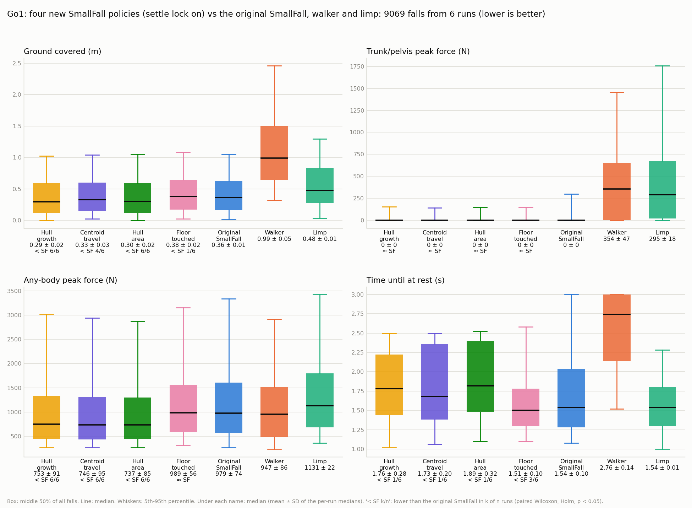
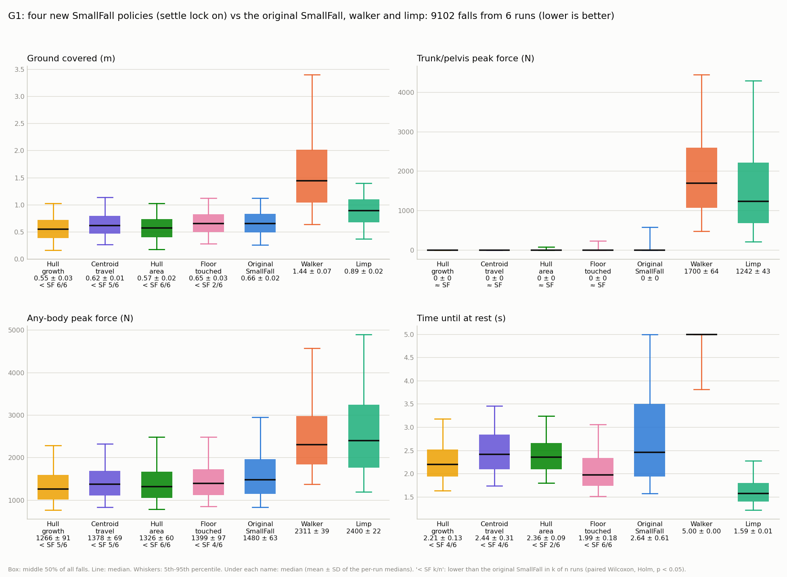

# SmallFall results: Go1 and G1, six seeds, seven policies

Final results of the fall-protection pipeline on both robots (run `e2e1`,
November 2026). Every decision and pass rule is logged in
[`DEVIATIONS.md`](../DEVIATIONS.md); the earlier five-run Go1 study with the
original SmallFall alone is in [`GO1_MULTISEED_REPORT.md`](GO1_MULTISEED_REPORT.md).

## Setup

- **Pipeline:** a walking policy is pushed (Go1 150 N, G1 200 N, at the
  trunk/torso). An MLP fall predictor watches every step. When it fires,
  control switches permanently to a SmallFall policy.
- **Seeds:** 6 per robot (0-5). Each seed trains its own predictor and its
  own five SmallFall policies, and has its own fall banks: one to train, one
  to test, three to evaluate. The walker is shared within a robot.
- **Evaluation:** about 1,500 predictor-flagged fall states per seed are
  replayed under all seven policies from the identical start, so every
  comparison is paired on the fall. Tests run within each seed (paired
  Wilcoxon signed-rank, Holm-adjusted); tables report the mean ± SD of the
  six per-seed medians and the number of seeds in which a difference is
  significant (p < 0.05).
- **Main measure:** ground covered, how far the farthest body part gets from
  where the fall started, minus how far it already was at the start.

## The seven policies

| Policy | Reward / behavior |
|---|---|
| **Hull growth** | pays for the growth of the convex hull of all body positions over the fall, minus the start pose's hull (floor area the fall sweeps) |
| **Hull area** | the swept hull area itself |
| **Centroid travel** | how far the mean of all body positions moves |
| **Floor touched** | floor area touched: 10 cm cells that held a ground-touching body |
| Original SmallFall | the ground-covered (envelope) reward plus a peak-impact term |
| Walker | the walking policy keeps control (no hand-off) |
| Limp | motors off at the flag moment |

The four new policies share the original's other reward terms; the new term
pays its weight times the per-step growth of its measure, with the weight set
so it costs as much per fall as the ground-covered term. They train for 600
iterations without, and run with, a **settle lock**: the joints hold their pose
once the robot is low and still, or after a fixed time (Go1 1.8 s, G1 3.0 s).

## Go1 (quadruped): 9,069 falls

| Policy | Ground covered (m) | Below original in | Any-body peak force (N) | Time to rest (s) | Came to rest |
|---|---|---|---|---|---|
| **Hull growth** | **0.294 ± 0.024** | 6 / 6 | 753 ± 91 | 1.76 ± 0.28 | 99.9% |
| Hull area | 0.302 ± 0.020 | 6 / 6 | 737 ± 85 | 1.89 ± 0.32 | 99.5% |
| Centroid travel | 0.328 ± 0.026 | 4 / 6 | 746 ± 95 | 1.73 ± 0.20 | 99.3% |
| Original SmallFall | 0.363 ± 0.012 | | 979 ± 74 | 1.54 ± 0.10 | 91.2% |
| Floor touched | 0.377 ± 0.024 | 1 / 6 | 989 ± 56 | 1.51 ± 0.10 | 99.5% |
| Limp | 0.476 ± 0.007 | | 1,131 ± 22 | 1.54 ± 0.01 | 99.6% |
| Walker | 0.985 ± 0.050 | | 947 ± 86 | 2.76 ± 0.14 | 56.3% |

Trunk peak force is 0 N median for every SmallFall policy (walker 354 N,
limp 295 N). Hull growth, hull area and centroid travel also lower the any-body
peak force below the original's in 6/6 seeds.

## G1 (humanoid): 9,102 falls

| Policy | Ground covered (m) | Below original in | Any-body peak force (N) | Time to rest (s) | Came to rest |
|---|---|---|---|---|---|
| **Hull growth** | **0.550 ± 0.030** | 6 / 6 | 1,266 ± 91 | 2.21 ± 0.13 | 100% |
| Hull area | 0.569 ± 0.022 | 6 / 6 | 1,326 ± 60 | 2.36 ± 0.09 | 100% |
| Centroid travel | 0.619 ± 0.013 | 5 / 6 | 1,378 ± 69 | 2.44 ± 0.31 | 100% |
| Floor touched | 0.655 ± 0.029 | 2 / 6 | 1,399 ± 97 | 1.99 ± 0.18 | 100% |
| Original SmallFall | 0.655 ± 0.024 | | 1,480 ± 63 | 2.64 ± 0.61 | 87.6% |
| Limp | 0.887 ± 0.020 | | 2,400 ± 22 | 1.59 ± 0.01 | 99.9% |
| Walker | 1.44 ± 0.07 | | 2,311 ± 39 | 5.00 (episode cap) | 8.2% |

Pelvis peak force is 0 N median for every SmallFall policy (walker 1,700 N,
limp 1,242 N). Hull growth covers less ground than hull area in 5/6 seeds.

## Fall predictor and hand-off (mean ± SD over 6 seeds)

| | Go1 | G1 |
|---|---|---|
| Test AUPRC (MLP) | 0.850 ± 0.019 | 0.940 ± 0.005 |
| Test AUPRC (logistic regression) | 0.725 ± 0.020 | 0.899 ± 0.009 |
| Base rate | 0.02 | 0.02 |
| Live recall | 1.00 | 1.00 |
| Live precision | 0.76 ± 0.06 | 0.97 ± 0.02 |
| Live median warning | 0.33 s | 0.35 s |

The MLP beats logistic regression and chance in 6/6 seeds on both robots
(paired bootstrap).

## Verdicts

The pass rule, fixed in `DEVIATIONS.md` before the data existed, was applied
to hull growth on each seed's untouched test bank:

- **Go1:** less ground covered than walker and limp, ≥ 99% come to rest,
  trunk force and peak torque below the walker's. **PASS in 6/6 seeds.**
- **G1:** less ground covered than walker and limp, ≥ 99% come to rest,
  pelvis force no higher than the walker's, any-body force below limp's.
  **PASS in 6/6 seeds.**

## Findings

1. **Hull growth is the best SmallFall reward on both robots.** It covers 19%
   (Go1) and 16% (G1) less ground than the original SmallFall, significant in
   every seed, and it beats the walker and limp by a wide margin.
2. **The safety measures improve too.** The new policies come to rest in
   99-100% of falls (original 88-91%) and lower the hardest impact on any
   body part.
3. **The cost is time.** Hull growth takes about 0.2 s longer than the
   original to come to rest on the Go1. On the G1 it comes to rest faster.
4. **Floor touched is no improvement** over the original on either robot.

## Limitations

- Simulation only (MuJoCo Warp); no hardware tests.
- MuJoCo Warp is not bit-deterministic, so re-collected banks differ slightly
  (e.g. 1,510 vs 1,520 falls); every comparison uses one set of falls.
- The walker is shared within a robot, so seed-to-seed spread reflects the
  predictor, the SmallFall training and the sampled falls, not walker training.
- The limp baseline is idealized (no added joint friction or damping).
- False alarms: 24% (Go1) and 3% (G1) of live flags are not followed by a
  fall; their cost is not measured.
- Ground covered is this project's own measure, not from the literature.

## Files (local, not in the repository)

Per-fall data, per-seed tests, checkpoints and videos are in
`outputs/go1/end_to_end/` and `outputs/g1/end_to_end/`; the tables above are
from `outputs/stats/policies/policy_stats.md` and
`outputs/stats/multiseed/multiseed_stats.md` in each. Reproduce with
[`notebooks/go1_end_to_end.ipynb`](../notebooks/go1_end_to_end.ipynb) and
[`notebooks/g1_end_to_end.ipynb`](../notebooks/g1_end_to_end.ipynb)
(`RUN_NAME = "e2e1"`, `SEEDS = (0, 1, 2, 3, 4, 5)`).
